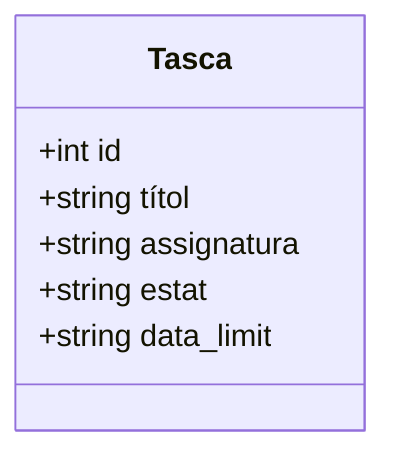

# SPECIFICATIONS.md — Sistema Tasks_app (v1.0)

## 1. Visió General
Tasks_app és una eina CLI lleugera per ajudar als estudiants a gestionar les seves tasques acadèmiques diàries.

## 2. User Stories (Històries d'Usuari)
- US-01: Com a estudiant, vull afegir una tasca amb títol i assignatura per recordar els meus deures.
- US-02: Com a estudiant, vull veure la llista de tasques pendents per organitzar el meu temps.
- US-03: Com a estudiant, vull indicar una data límit opcional en crear una tasca per controlar quan venç cada lliurament.
- US-04: Com a estudiant, vull visualitzar etiquetes d'alerta (`[CADUCADA]` o `[URGENT]`) en llistar les tasques pendents per prioritzar les més properes.
- US-05: Com a estudiant, vull modificar qualsevol atribut d'una tasca existent a partir del seu identificador per corregir possibles errors en registrar-la.
- US-06: Com a estudiant, vull marcar una tasca com a completada a partir del seu identificador per portar el control de la feina feta.

## 3. Model de Dades (Mermaid)

## 4. Requisits
- RF-01 : El sistema tasks_app ha de guardar les tasques en un fitxer JSON de persistència local.
- RF-02 : Si el fitxer `data/tasks.json` no existeix, el sistema tasks_app ha de crear `data/tasks.json`  inicialitzat amb una llista JSON buida ([])
- RF-03 : El sistema tasks_app ha de proveir a l'estudiant la capacitat de crear una nova tasca amb estat 'pendent' mitjançant el comandament add --title <títol> --subject <assignatura>.
- RF-04: El sistema tasks_app ha de proveir a l’estudiant la capacitat de visualitzar totes les tasques registrades (incloent-hi el seu ID, títol, assignatura i estat) mitjançant el comandament list.
- RF-05: El sistema tasks_app ha de proveir a l'estudiant la capacitat d'assignar opcionalment una data límit en format YYYY-MM-DD en crear una tasca mitjançant el comandament add --title <títol> --subject <assignatura> [--due YYYY-MM-DD] (emmagatzemant null si no s'especifica).
- RF-06: Si una tasca amb estat 'pendent' té una data límit estrictament anterior al dia actual, el sistema tasks_app ha de mostrar l'etiqueta [CADUCADA] al final de la seva línia en llistar-la.
- RF-07: Si una tasca amb estat 'pendent' té una data límit igual o posterior al dia actual però inferior a 7 dies vista, el sistema tasks_app ha de mostrar l'etiqueta [URGENT] al final de la seva línia en llistar-la.
- RF-08: El sistema tasks_app ha de proveir a l'estudiant la capacitat de modificar qualsevol atribut d'una tasca existent (--title, --subject, --due, --status) identificant-la mitjançant el comandament edit --id <ID> [--title <títol>] [--subject <assignatura>] [--due <YYYY-MM-DD>] [--status <estat>].
- RF-09: El sistema tasks_app ha de proveir a l'estudiant la capacitat de marcar una tasca existent com a 'completada' identificant-la mitjançant el comandament complete --id <ID>.

## 5. Criteris d’acceptació i proves (Gherkin scenarios)
- GS-01: Creació correcta d'una tasca
  Atès que la base de dades JSON no conté encara tasques
  quan l’estudiant executa `python src/tasks_app.py add --title 'Pràctica 1' --subject 'RS'
  aleshores el sistema confirma `Tasca [ID: 1] creada amb èxit`
  i la tasca queda registrada al fitxer `data/tasks.json`.

- GS-02: Llistat de tasques quan `data/tasks.json` no conté registres 
  Atès que la base de dades JSON no conté encara tasques
  quan l’estudiant executa `python src/tasks_app.py list`
  aleshores el sistema mostra `Registre de tasques buit.` 

- GS-03: Llistat de tasques quan data/tasks.json conté registres
  Atès que el fitxer `data/tasks.json` conté les següents tasques:
    | id | títol          | assignatura | estat   |
    | 1  | Pràctica 1     | RS          | pendent |
    | 2  | Examen parcial | SO          | pendent |
  quan l’estudiant executa `python src/tasks_app.py list`
  aleshores el sistema mostra per pantalla:
    "[1] Pràctica 1 (RS) - estat: pendent"
    "[2] Examen parcial (SO) - estat: pendent"
- GS-04: Creació d'una tasca amb data límit
Atès que la base de dades JSON no conté encara tasques
quan l'estudiant executa python src/tasks_app.py add --title 'Entrega RS' --subject 'RS' --due 2026-12-01
aleshores el sistema confirma Tasca [ID: 1] creada amb èxit
i la tasca queda registrada al fitxer data/tasks.json amb data_limit igual a '2026-12-01'.
- GS-05: Llistat d'una tasca pendent caducada
Atès que el fitxer data/tasks.json conté una tasca pendent amb ID 1, títol 'Pràctica antiga', assignatura 'RS' i data_limit anterior a la data actual
quan l'estudiant executa python src/tasks_app.py list
aleshores el sistema mostra per pantalla:
"[1] Pràctica antiga (RS) - estat: pendent [CADUCADA]"
- GS-06: Llistat d'una tasca pendent urgent (menys de 7 dies)
Atès que el fitxer data/tasks.json conté una tasca pendent amb ID 2, títol 'Examen demà', assignatura 'SO' i data_limit a 2 dies vista de la data actual
quan l'estudiant executa python src/tasks_app.py list
aleshores el sistema mostra per pantalla:
"[2] Examen demà (SO) - estat: pendent [URGENT]"
- GS-07: Modificació dels atributs d'una tasca existent per ID Atès que el fitxer data/tasks.json conté una tasca amb ID 1, títol 'Pràctica 1', assignatura 'RS' i estat 'pendent' quan l'estudiant executa python3 src/tasks_app.py edit --id 1 --title 'Pràctica 1 Corregida' --due 2026-12-15 aleshores el sistema confirma Tasca [ID: 1] modificada amb èxit i al fitxer data/tasks.json la tasca amb ID 1 té el títol 'Pràctica 1 Corregida' i data_limit igual a '2026-12-15'.
- GS-08: Marcar una tasca com a completada per ID Atès que el fitxer data/tasks.json conté una tasca amb ID 1, títol 'Pràctica 1', assignatura 'RS' i estat 'pendent' quan l'estudiant executa python3 src/tasks_app.py complete --id 1 aleshores el sistema confirma Tasca [ID: 1] marcada com a completada i al fitxer data/tasks.json la tasca amb ID 1 té l'estat 'completada'.
